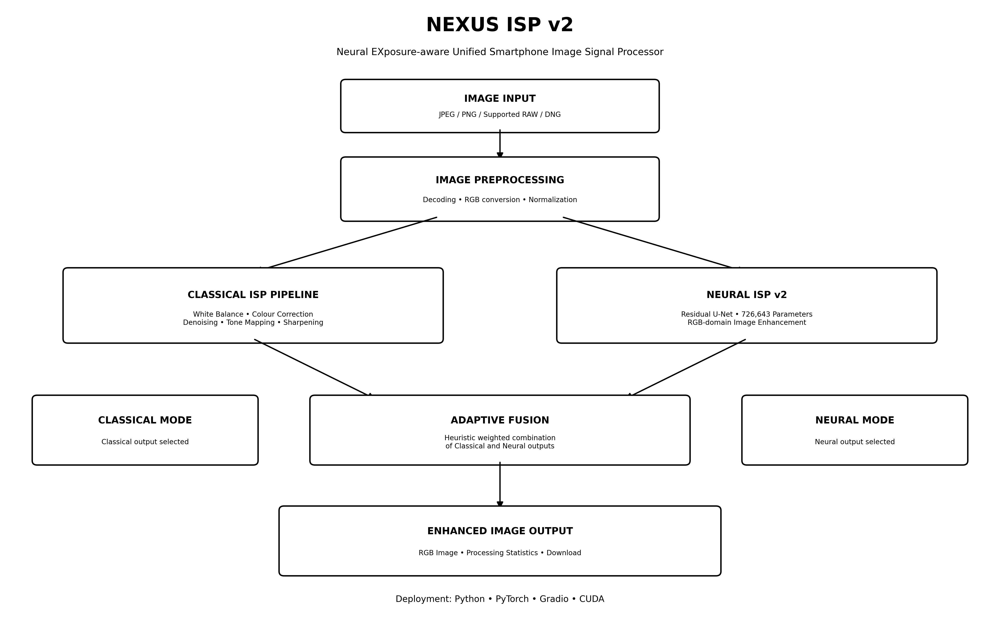
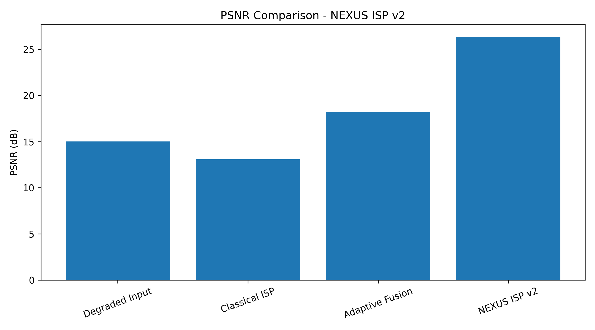
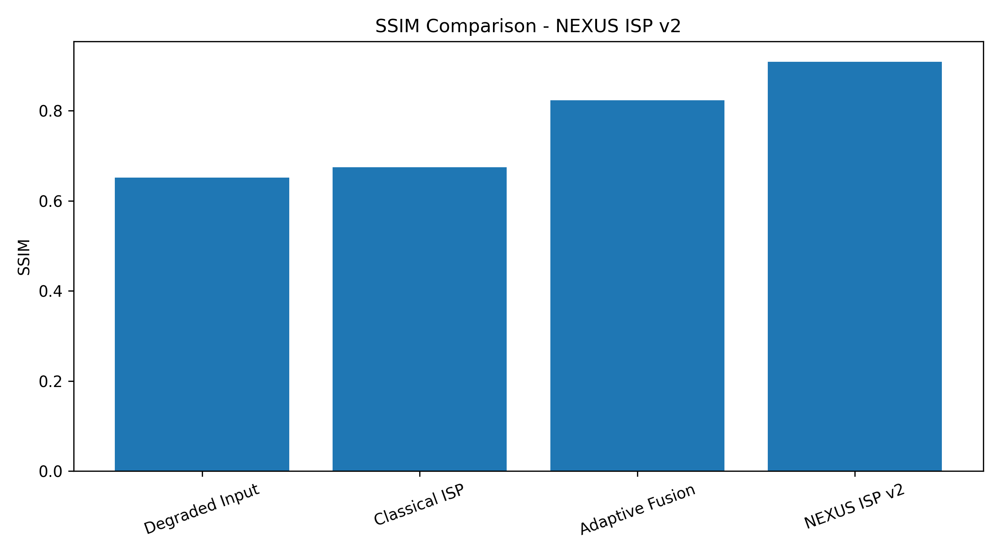
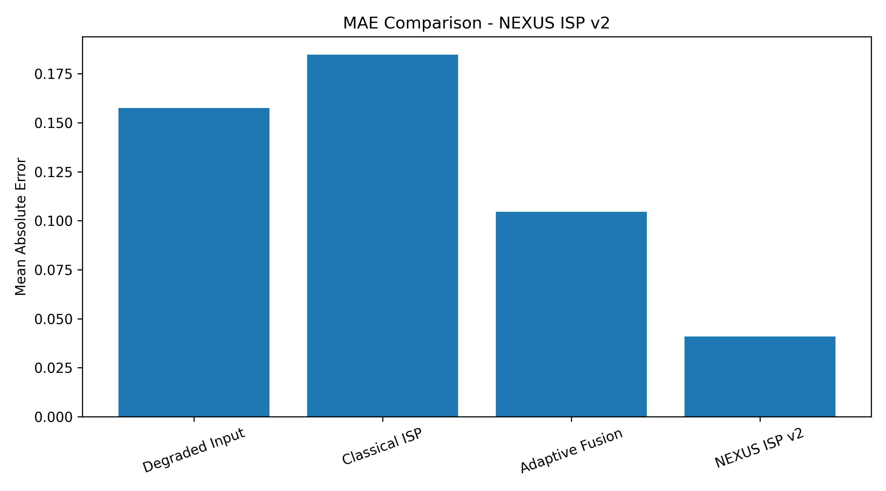

# NEXUS ISP v2
### Neural EXposure-aware Unified Smartphone Image Signal Processor

NEXUS ISP is a hybrid image enhancement system combining classical Image Signal Processing with deep learning-based image enhancement.

## System Architecture


## Features
- Classical ISP pipeline
- Residual U-Net neural enhancement
- Adaptive fusion
- FP32 and FP16 inference
- Gradio web application
- JPEG, PNG and supported RAW/DNG input

## Model Architecture
- Architecture: Residual U-Net
- Parameters: 726,643
- Training epochs: 20
- Best epoch: 18
- Training GPU: NVIDIA Tesla T4
- Inference checkpoint: 2.79 MB

## Experimental Results

Results from the synthetic test dataset (238 patches).

| Method | PSNR (dB) | SSIM | MAE |
|---|---:|---:|---:|
| Degraded Input | 15.01 | 0.6514 | 0.15753 |
| Classical ISP | 13.07 | 0.6744 | 0.18469 |
| Adaptive Fusion | 18.18 | 0.8229 | 0.10460 |
| NEXUS ISP v2 | 26.35 | 0.9082 | 0.04093 |

### PSNR Comparison


### SSIM Comparison


### MAE Comparison


## Performance Benchmark
- Inference latency: 3.27 ms
- Throughput: 306.11 images/sec
- Peak GPU memory allocated: 33.81 MB
- Hardware: NVIDIA Tesla T4
- Input size: 128x128
- Batch size: 1
- Precision: FP16

Note: This is a model-only GPU benchmark, not an end-to-end application or mobile-device benchmark.

## Dataset
- Total unique images: 788
- Training: 551
- Validation: 118
- Testing: 119

## Technology Stack
- Python
- PyTorch
- OpenCV
- NumPy
- Gradio
- CUDA
- Matplotlib

## Technical Limitations
- Neural enhancement operates in the RGB domain.
- RAW/DNG files are decoded to RGB before processing.
- Direct neural Bayer RAW-to-RGB reconstruction is not implemented.
- Adaptive fusion uses heuristic weighting.
- Real-world testing revealed colour consistency issues.
- Synthetic benchmark results do not guarantee real-world performance.

## Installation

```bash
git clone https://github.com/rachitha39/NEXUS-ISP-v2.git
cd NEXUS-ISP-v2
pip install torch torchvision opencv-python numpy gradio rawpy
python app.py
```

## Repository Structure

```text
NEXUS-ISP-v2/
├── app.py
├── README.md
├── .gitignore
├── deployment/
│   ├── config.json
│   ├── nexus_isp_v2_config.json
│   └── nexus_isp_v2_inference.pth
└── Final_Results/
    ├── nexus_isp_architecture.png
    ├── nexus_isp_architecture.pdf
    ├── nexus_isp_architecture.svg
    ├── psnr_comparison.png
    ├── ssim_comparison.png
    ├── mae_comparison.png
    ├── nexus_isp_metrics.csv
    └── nexus_isp_final_results.json
```

## Future Improvements
- Improve colour consistency.
- Expand the training dataset.
- Improve adaptive fusion.
- Optimize inference for mobile and edge devices.
- Explore direct RAW-to-RGB reconstruction.

## GitHub Repository
https://github.com/rachitha39/NEXUS-ISP-v2
